# Architecture

For developers of lollo-rozzo: what runs for one person, with every profile on, how the parts reach each other, and where each part lives in this repo. The same system in plain terms, for those who install and run it, is [docs/architecture.md](docs/architecture.md). Each person has a stack like this one: its own Compose project (`lollo-<name>`), Cloudflare Tunnel, two Cloudflare Access applications and state directory. Only the document tools' Gotenberg and volume are shared by the stacks of a host.

An interactive version, [lollo-rozzo-overview.html](docs/diagrams/lollo-rozzo-overview.html), opens in a browser from a clone of this repo. Each folder's README has a narrower diagram of its own part.

## Two hosts per stack
| Host | Access application | Tunnel routes it to |
|---|---|---|
| `<name>.<domain>` | Lettuce's (`CF_ACCESS_AUD`) | `app-server:8080`, the BFF's port in the app-server's network namespace |
| `<name>-lollo.<domain>` | the lollo's (`CF_LOLLO_AUD`) | `^/vault(/\|$)` to `lollo-vault:8000`, `^/gmail-triggers(/\|$)` to `lollo-gmail-triggers:8000`, `^/news-radar(/\|$)` to `lollo-news-radar:8000`, `^/code-server(/\|$)` to `lollo-code-server:8000`, `^/browser(/\|$)` to `lollo-browser:8000` (each only with its profile), `^/notifications(/\|$)` to `lollo-notifications:8000` (with `lollo-vault` or `lollo-browser`), `^/(assets/[^/]+)?$` to `landing:8000` (with any of them); anything else gets a 404 |

Both applications share the stack's Access policy, so `lolloctl users` changes who may sign in to both. The lollo's services accept only the lollo's tokens, never Lettuce's, which agents could catch inside the app-server's namespace. The routes are written by `cf_tunnel_configure` ([lib/cloudflare.sh](lib/cloudflare.sh)) from `PROFILE_ROUTES`, on `add` and on every `profiles` run. `/executor/v1/` and `/healthz` are never routed.

## Containers
| Service | From | Profile | Networks | Mounts |
|---|---|---|---|---|
| `cloudflared` | upstream | `cloudflared` (required) | `default` | none |
| `app-server` | upstream | always | `default`; `lollo-doc-tools-<name>` with `lollo-doc-tools` | `state/letta-home`, `letta-data`, `workspaces`, `tools`, `task-logs` (its `TMPDIR` since Lettuce v0.50.2: background commands' output and subagent runs' logs); the doc-tools volume read-only with `lollo-doc-tools` |
| `bff` | upstream | always | the app-server's namespace | `google-policy`, `google-creds`, `bff-data`, `bff-auth`, `workspaces` (read-write since Lettuce v0.42, for the Files tab's delete), `task-logs` (read-write since Lettuce v0.50.2, for Runs -> subagent runs and its 14-day cleanup); `letta-home` and the memory files read-only |
| `channel-gateway` | upstream | `telegram` | the app-server's namespace | `letta-home`, `letta-data`, `workspaces` |
| `searxng`, `ddg-mcp` | upstream | `search` | `default` | none |
| `google-mcp` | upstream | `google` | `default` | `google-policy` read-only, `google-creds` |
| `landing` | [landing/](landing/README.md) | any lollo page profile | `default` | none |
| `lollo-vault` | [vault/](vault/README.md) | `lollo-vault` | `default` | `vault-data` |
| `lollo-gmail-triggers` | [gmail-triggers/](gmail-triggers/README.md) | `lollo-gmail-triggers` | `default` | `state/lollo/gmail-triggers`; `google-creds` and `google-policy` read-only |
| `lollo-news-radar` | [news-radar/](news-radar/README.md) | `lollo-news-radar` | `default` | `news-radar-data` |
| `lollo-pipelock` | [pipelock/](pipelock/README.md) | `lollo-pipelock` | `default`, `browser` | `pipelock-data` |
| `lollo-code-server` (the gate) | [code-server/](code-server/README.md) | `lollo-code-server` | `default` | `code-server-sock` read-only |
| `lollo-code-server-editor` | [code-server/editor/](code-server/README.md) | `lollo-code-server` | `code-exec` | `workspaces`, `code-server-data`, `code-exec-keys`, `code-server-sock` |
| `lollo-code-server-exec` (the shell) | [code-server/exec/](code-server/README.md) | `lollo-code-server` | `code-exec`, `code-egress` | `workspaces`, `tools`, `code-exec-keys` read-only |
| `lollo-browser` | [browser/service/](browser/README.md) | `lollo-browser` (needs `lollo-pipelock`) | `default`, `browser` | `browser-data` |
| `lollo-browser-engine` | [browser/engine/](browser/README.md) | `lollo-browser` | `browser` | none (tmpfs `/tmp` only); our seccomp profile |
| `lollo-notifications` | [notifications/](notifications/README.md) | `lollo-vault`, `lollo-browser`, `lollo-gmail-triggers` or `lollo-news-radar` (none of its own) | `default` | `notifications-data` |
| `gotenberg` (project `lollo_shared`, one per host) | [compose/shared/](compose/README.md) | `lollo-doc-tools` | its own internal network and each stack's `lollo-doc-tools-<name>` | none |

`state/` is `stacks/<name>/state/` on the host. Every service runs with `no-new-privileges` and a memory cap ([compose/hardening.yml](compose/hardening.yml)); every container in the app-server's namespace, and every upstream helper on the stack network (`cloudflared`, `searxng`, `ddg-mcp`, `google-mcp`), drops `NET_RAW`; the lollo's services, the code editor, pipelock and the browser's engine are read-only with every capability dropped (the engine keeps Chromium's sandbox with a seccomp profile of ours, `browser/engine/seccomp.json`, instead of a capability). The code editor's shell is the exception: it is as strong as an agent, so it keeps Docker's default capabilities but `NET_RAW` and a writable root. [compose/README.md](compose/README.md) describes each overlay, and `lolloctl check` refuses a stack that departs from this table ([CONTRIBUTING.md](CONTRIBUTING.md#what-check_stack-enforces)).

## Networks
| Network | Internal | Members | Made by |
|---|---|---|---|
| `default` (one per stack) | no | every stack service but the editor, the shell and the browser's engine | Compose |
| `browser` | yes | the browser's engine, `lollo-browser` and `lollo-pipelock`: the engine's only way out is pipelock, which refuses every stack's Lettuce and lollo hosts and the Access team domain (`LOLLO_DENY_HOSTS`); pipelock joins it whatever the profiles | Compose |
| `code-exec` | yes | the editor and the shell | Compose |
| `code-egress` | no | the shell: its only way out | Compose |
| `lollo-doc-tools-<name>` | yes | the app-server and Gotenberg (alias `gotenberg`) | lolloctl (`sync_doc_tools`) |
| `lollo_shared`'s `internal` | yes | Gotenberg | Compose, project `lollo_shared` |

## Volumes
| Volume | Mounted by | Notes |
|---|---|---|
| `vault-data` | `lollo-vault` | the encrypted vault; `backup` copies it read-only, `restore` puts it back |
| `news-radar-data` | `lollo-news-radar` | monitors, sources, items, reports; `backup` copies it read-only, `restore` puts it back |
| `browser-data` | `lollo-browser` | kept sign-ins (per site), settings, hand-offs, audit log; never backed up, so sign-ins and settings are made again after a restore |
| `notifications-data` | `lollo-notifications` | every device's push subscription for the lollo's notifications; `backup` copies it read-only, `restore` puts it back |
| `pipelock-data` | `lollo-pipelock` | receipt signing key and receipts; `backup` and `receipts` read it read-only, `restore` puts it back |
| `google-creds`, `google-policy` | `bff`, `google-mcp`, `lollo-gmail-triggers` (read-only) | upstream's; never the app-server; `backup --with-google` copies them read-only, `restore` puts them back |
| `bff-data`, `bff-auth` | `bff` | upstream's |
| `code-server-data` | the editor | its settings and state |
| `code-exec-keys` | the editor (writes), the shell (read-only) | the SSH keys between them |
| `code-server-sock` | the editor, the gate (read-only) | the editor's Unix socket, its only listener |
| `lollo-doc-tools-<tag>` | every app-server, read-only | one per host, filled by lolloctl; not a Compose volume |

Named volumes of a stack are deleted with it by `lolloctl remove` (`compose down -v`). The host paths under `stacks/<name>/state/` are kept unless `--purge`.

## Who calls whom
| From | To | How |
|---|---|---|
| The BFF | the app-server | the only connection to agents; nothing else opens one or starts a turn |
| The BFF | `searxng`, `ddg-mcp` | backends of the agents' web search and page fetch |
| Agents (app-server) | `google-mcp` | MCP over HTTP, as Settings -> Google Workspace allows |
| Agents | `lollo-vault` | MCP at `http://lollo-vault:8000/mcp`; `vault-run` at `/redeem` |
| Agents | `lollo-news-radar` | MCP at `http://lollo-news-radar:8000/mcp` |
| Agents | `lollo-browser` | MCP at `http://lollo-browser:8000/mcp`; vault values piped into its typing tool with `vault-run`/`vault-fill` (it never calls the vault) |
| Agents | `lollo-pipelock` | `HTTPS_PROXY` (advisory) and `/fetch` for scanned pages |
| Agents | Gotenberg | the PDF MCP, started per call from the doc-tools volume |
| The lollo executor (cron in the app-server) | `landing`, `lollo-gmail-triggers`, `lollo-news-radar` | `/executor/v1/` with `LOLLO_EXECUTOR_TOKEN`: the agent list, and the requests of Gmail triggers and News Radar, which it runs as `letta cron add --once` ([landing/executor/README.md](landing/executor/README.md)) |
| `lollo-gmail-triggers` | Gmail | read-only, with the token Settings -> Google stores |
| `lollo-vault`, `lollo-browser`, `lollo-gmail-triggers`, `lollo-news-radar` | `lollo-notifications` | `/notify/v1/send` with each sender's own token (`NOTIFY_TOKEN`), held only by it and the service, never by the app-server; the service then sends Web Push with the lollo's VAPID key ([notifications/README.md](notifications/README.md#rules)) |
| `lollo-browser` | the browser's engine | Playwright's WebSocket at a path made from `BROWSER_ENGINE_SECRET`, and the display (VNC), which it relays to the person's page at `/browser/` |
| The browser's engine | `lollo-pipelock` | every request Chromium makes, loopback included: its only way out, so pipelock refuses private addresses for it ([pipelock/README.md](pipelock/README.md#rules)) |
| `lollo-news-radar` | public websites | the sources agents set up: public addresses only, robots.txt honoured (a feed's own URL excepted), not through pipelock |
| The gate | the editor | the editor's Unix socket |
| The editor | the shell | SSH, for terminals and every git call |

## How a stack is assembled
Each stack runs as Compose project `lollo-<name>` with `--env-file stacks/<name>/stack.env`: Lettuce's own `upstream/<LETTUCE_REF>/docker/compose.yml` (both in the data directory, below), then this repo's overlays, merged in a fixed order by the `compose` wrapper. [compose/README.md](compose/README.md) lists each file in that order, when it is merged and what it does. With `lollo-doc-tools`, the host also runs the Compose project `lollo_shared` (one Gotenberg for every stack). [CONTRIBUTING.md](CONTRIBUTING.md) covers working on the repo.

## What lives where
| Path | What |
|---|---|
| `lolloctl`, [`lib/`](lib/README.md) | the CLI; [lib/DESIGN.md](lib/DESIGN.md) is how it is installed without a clone |
| [`release/`](release/README.md), `VERSION`, `REBUILD` | releases: the published images' list (`release/images`), their content tags, the lolloctl image and its wrapper; the version, and the date that rebuilds every image |
| `.github/workflows/` | `ci.yml`, every check, on each branch push; `publish.yml`, after `ci.yml` passes, a release on each `v*` tag on `main` or a `hotfix/*` branch, and a dev build (a `lolloctl` image tag) for each pull request; `renovate.yml`, Renovate on its schedule ([CONTRIBUTING.md](CONTRIBUTING.md#dependency-updates)) |
| `.github/renovate.json5` | what Renovate updates and what merges on its own |
| `compose/hardening.yml` | `no-new-privileges`, memory caps for every service, a pid cap on the app-server, no `NET_RAW` where agents run nor in the upstream helpers on the stack network, letta-code self-update off |
| `compose/multi.yml` | drops all published ports, so stacks never collide |
| `compose/vault.yml`, [`vault/`](vault/README.md) | the optional vault (`lollo-vault` profile) and its source |
| `compose/gmail-triggers.yml`, [`gmail-triggers/`](gmail-triggers/README.md) | optional Gmail triggers (`lollo-gmail-triggers` profile) and their source |
| `compose/news-radar.yml`, [`news-radar/`](news-radar/README.md) | the optional News Radar (`lollo-news-radar` profile) and its source |
| `compose/pipelock.yml`, `compose/pipelock-proxy.yml`, [`pipelock/`](pipelock/README.md) | the optional egress proxy (`lollo-pipelock` profile), its proxy settings and its image |
| `compose/code-server.yml`, [`code-server/`](code-server/README.md) | the optional code editor (`lollo-code-server` profile): its gate, the editor's image and the shell's image |
| `compose/browser.yml`, [`browser/`](browser/README.md) | the optional agents' browser (`lollo-browser` profile): the engine (Chromium and its display) and `lollo-browser` (the agents' tools and the person's page), their internal network and volume |
| `compose/notifications.yml`, [`notifications/`](notifications/README.md) | the lollo's notifications service (on with `lollo-vault`, `lollo-browser`, `lollo-gmail-triggers` or `lollo-news-radar`): the one sender of Web Push for them, and the page at `/notifications/` |
| `compose/landing.yml`, [`landing/`](landing/README.md) | the lollo's landing page (on with `lollo-vault`, `lollo-gmail-triggers`, `lollo-news-radar`, `lollo-code-server` or `lollo-browser`) and the lollo executor ([landing/executor/](landing/executor/README.md)), which runs the requests of Gmail triggers and News Radar and sends the landing page the agent list |
| `compose/doc-tools.yml`, `compose/shared/gotenberg.yml`, [`doc-tools/`](doc-tools/README.md) | the optional Office and PDF tools (`lollo-doc-tools` profile): the app-server's mount and network, the host's shared Gotenberg, and the tools' image and PDF server |
| [`lollo-common/`](lollo-common/README.md) | code the lollo services share (sign-in checks, the executor API's checks, page styles, icons) |
| [`agent-skills/`](agent-skills/README.md) | skills `lolloctl skills` installs for every agent of every stack |
| [`backup/`](backup/README.md) | the image `lolloctl backup` and `restore` copy with (it also fills the doc-tools volume) |
| `docs/` | the guides for users and admins, and [diagrams](docs/diagrams/) (archify: `.json` source, interactive `.html`, `.svg`) for every audience |
| `config.env.example` | template for `config.env` |
| `scripts/dns-preflight.sh` | compares two nameservers before and after moving a domain (`lolloctl dns-preflight`) |
| `scripts/doc-tools-e2e.sh`, `scripts/code-server-e2e.sh` | end-to-end runs of the document tools and the code editor against real images |
| `scripts/check-ci-gate.sh` | checks that CI's `ci-passed` job, the one check the `main` ruleset requires, waits for every other job |
| `scripts/check-doc-links.mjs` | checks the Markdown's relative links and anchors, and each folder README's agents' pointer |
| `scripts/renovate-post-upgrade.sh` | recomputes the hashes, tag commit and lock that go with a version Renovate moved |
| `tests/` | offline tests (`tests/run.sh`; docker, curl, dig, gh and secret-tool are stubbed), the sidecars' tests (`tests/run-sidecar.sh vault`, `tests/run-sidecar.sh gmail-triggers`, `tests/run-sidecar.sh news-radar`, `tests/run-sidecar.sh code-server`, `tests/run-sidecar.sh landing`, `tests/run-sidecar.sh doc-tools`, `tests/run-sidecar.sh browser`, `tests/run-sidecar.sh notifications`) and pipelock's (`tests/run-pipelock.sh`) |

Instance data lives in a data directory apart from the code: `~/lollo-rozzo` for a release install (or wherever its admin put it), the clone's untracked `data/` for a clone (`LOLLO_DATA` names another). [docs/operations.md](docs/operations.md#files-on-the-host) lists what is in it.

What each part does, and why it is built the way it is, is in its folder's README; how to use and run it, and its security model, in its guide under `docs/`. The design records of the larger features are next to their code: [code-server/DESIGN.md](code-server/DESIGN.md), [gmail-triggers/DESIGN.md](gmail-triggers/DESIGN.md), [landing/DESIGN.md](landing/DESIGN.md) (the lollo host) and [news-radar/DESIGN.md](news-radar/DESIGN.md).
